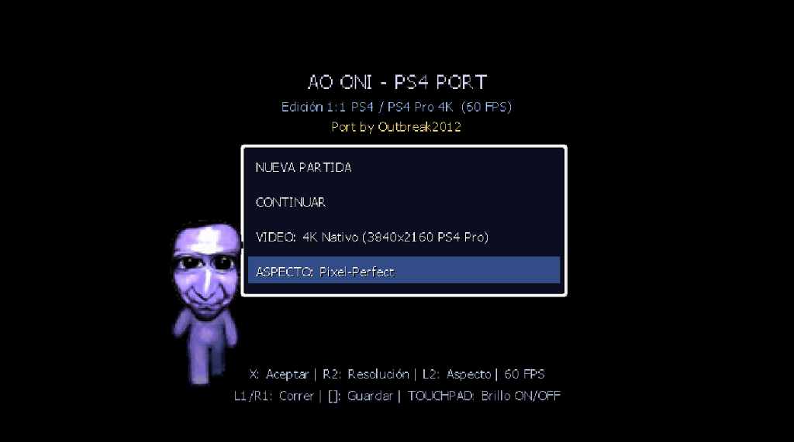
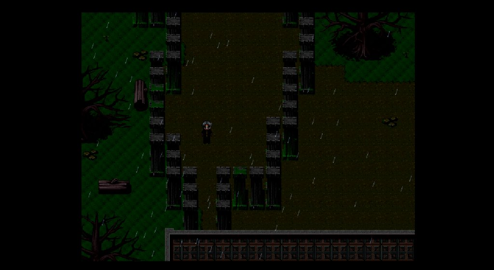
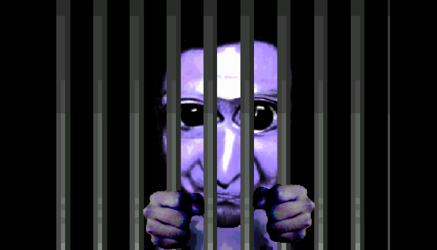
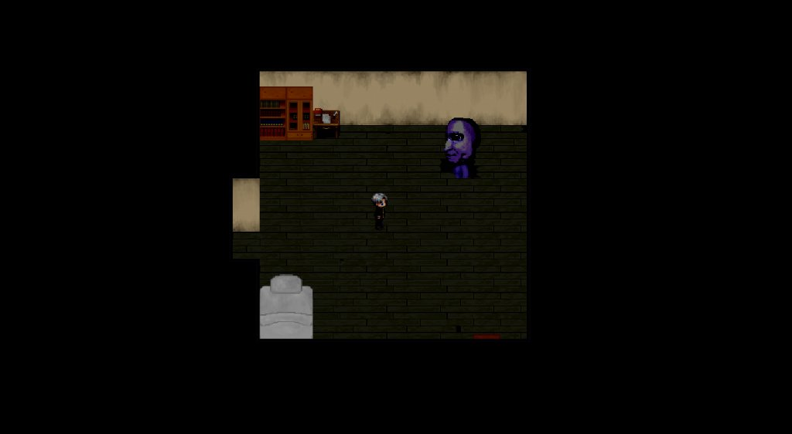

<div align="center">

# Ao Oni — PS4 / PS4 Pro Port (1:1)

**Port nativo en C++17 de *Ao Oni* (RPG Maker XP / RGSS1) para PlayStation 4 y PS4 Pro con GoldHEN**  
Desarrollado con **OpenOrbis PS4 Toolchain**, **SDL2** y salida nativa de hardware (`sceVideoOut` / `sceAudioOut`).

[](https://github.com/Outbreak2012/Ao-Oni-ps4-port/releases/latest)
[-003791?style=for-the-badge&logo=playstation)](https://github.com/Outbreak2012/Ao-Oni-ps4-port)
[](#características-principales)
[](#características-principales)

**Autor del port:** [Outbreak2012](https://github.com/Outbreak2012/Ao-Oni-ps4-port) · **Title ID:** `AONI00001` (`IV0000-AONI00001_00-AOONIPS4PORT0000`)

<br>



</div>

---

## Capturas en ejecución

| Menú principal (4K / Pixel-Perfect) | Exterior bajo la lluvia |
| :---: | :---: |
|  |  |
| **Cinemática de la reja** | **Persecución en la mansión** |
|  |  |

---

## Descarga e instalación rápida (PS4 con GoldHEN)

1. Descarga `IV0000-AONI00001_00-AOONIPS4PORT0000.pkg` desde [**Releases**](https://github.com/Outbreak2012/Ao-Oni-ps4-port/releases/latest).
2. Copia el `.pkg` a la raíz de un USB en formato `exFAT` / `FAT32`.
3. En tu PS4 con **GoldHEN**, ve a **GoldHEN → Package Installer** e instala el paquete.
4. Ejecuta **Ao Oni PS4** directamente desde el menú XMB.

---

## Características principales

### Motor nativo RGSS1 1:1 en C++17
- **Intérprete completo sin dependencias de Ruby** ([`src/aooni_ps4/aooni/main.cpp`](src/aooni_ps4/aooni/main.cpp)): ejecuta eventos, rutas de movimiento (`cmd 205` / `cmd 209`, incluyendo saltos parabólicos `Jump`), clima de lluvia (`cmd 236`), rotación de imágenes (`cmd 233`), animaciones (`cmd 207`), variables, interruptores y colisiones originales de RPG Maker XP.
- **Ordenación Z (`screen_z`) fiel a RGSS1**: intercalado exacto por profundidad entre sprites (`32x48` / `32x32`), tilesets, autotiles con prioridad `> 0` y eventos `always_top`, evitando recortes o solapamientos con armarios, estanterías, camas o árboles.

### Vídeo y rendimiento (60 FPS nativos)
- **Bloqueado a 60 FPS con VSync nativo**: presentación directa mediante `sceVideoOutSubmitFlip` sin dobles esperas de VSync.
- **Resoluciones hasta 4K Nativo (`3840x2160`)**: renderizado base `640x480` escalado por hardware a **720p**, **1080p** o **4K Nativo (PS4 Pro)** con relación de aspecto **4:3**, **16:9** o **Pixel-Perfect**.
- **Optimizaciones de renderizado**: tabla **LUT de 256 entradas** para tonos de pantalla (`applyToneRectFast`), caché directa de superficies `SDL_Surface*` por evento/tileset/autotile y limpieza única de bordes negros en VRAM al cambiar de modo de vídeo.

### Fidelidad gráfica e interfaz
- **Windowskin original (`ws_wskin_n.png`)**: cuadros de diálogo con ajuste automático de línea y soporte completo de acentos/español, menú de título, teclado numérico compacto (`cmd 103`), pantalla de nombre con respuesta inmediata de cruceta e inventario paginado.
- **Objetos visibles sin perder el estilo clásico**: los 42 ítems cuentan con su icono RTP completo, contraste reforzado en objetos pequeños/oscuros, destellos que se apagan automáticamente tras recoger cada objeto e **indicador contextual `[X]`** frente a interactuables (alternable con **TOUCHPAD**).
- **Correcciones de mapas y sprites**: rejas de celdas transparentes (`char_173-Door04.png`), enmascarado de salas auxiliares fuera de límites (`AT-hekitainai`), limpieza de microporos en tilesets, sprite correcto de epílogo (`char_148-Storekeeper02.png`), interruptor eléctrico de 4 estados y cuervos animados.

### Audio e inmersión DualShock 4
- **Mezclador multicanal `sceAudioOut` (48 kHz estéreo)**: BGM, BGS, ME y 6 canales SE simultáneos con pitch, volumen y fundidos (`fadeIn` / `fadeOut`).
- **Audio ambiental y de impacto mejorado**: BGS ambientales sin cortes (`Wind`, `Rain`, `Quake`, `Creature01` con parada automática al salir del cuarto/armarios) y sonido reforzado de reja metálica pesada (`027-Door04`) para la cinemática de la celda.
- **Inmersión háptica y Lightbar**: barra LED dinámica según el estado de persecución y **latido háptico progresivo por proximidad** (doble golpe *tum-tum* que se acelera conforme el Ao Oni se acerca a menos de 7 casillas, y pulso tenue al esconderse en armarios).

### Calidad de vida (QoL)
- Auto-guardado de punto de control al entrar en salas seguras y **guardado rápido** con **Cuadrado** en zonas seguras.
- Teclado numérico compacto para cajas fuertes y candados.
- Retardo de seguridad justo al aparecer un Ao Oni y ajuste equilibrado de persecuciones.

---

## Controles (DualShock 4)

| Botón | Acción |
| --- | --- |
| **Cruceta / Stick Izquierdo** | Mover a Hiroshi / navegar menús, teclado numérico y nombre |
| **X (Cruz)** | Interactuar / confirmar / avanzar diálogo |
| **Círculo** | Cancelar / volver |
| **Cuadrado** | Guardado rápido *(en zona segura o inventario)* |
| **Triángulo / OPTIONS** | Abrir o cerrar inventario |
| **L1 / R1** | Correr en el mapa / avance rápido de diálogo |
| **TOUCHPAD** | Activar o desactivar brillo de objetos e indicador `[X]` |
| **R2** | Cambiar resolución de salida (`720p` / `1080p` / `4K Nativo`) |
| **L2** | Cambiar relación de aspecto (`4:3` / `16:9` / `Pixel-Perfect`) |
| **L1 + R1 + OPTIONS** | Volver a la pantalla de título |

---

## Compilación desde el código fuente

> El repositorio **no distribuye los archivos originales ni el `.pkg`** dentro del árbol Git (`Ao Oni/` y `*.pkg` están en `.gitignore`). Para compilar por tu cuenta necesitas tu copia legal de **Ao Oni** en `Ao Oni/`, `PS4Toolchain/` en la raíz del proyecto, **WSL (Ubuntu)** (`clang`, `lld`, `make`, `python3`) y **Windows** (`PkgTool.Core.exe`).

1. **Exportar y parchear los assets nativos para PS4** (mapas `.bin`/`.json`, imágenes y audio PCM 48 kHz):
   ```powershell
   wsl -d Ubuntu -e python3 /mnt/<ruta-al-repo>/scripts/prepare_aooni_assets.py
   ```
   *(Se ejecuta automáticamente desde `build.ps1` si falta `src/aooni_ps4/assets/misc/map_001.bin`.)*

2. **Compilar `eboot.bin` y empaquetar el `.pkg`**:
   ```powershell
   powershell -ExecutionPolicy Bypass -File .\scripts\build.ps1 -Project aooni_ps4
   ```
   El `.pkg` resultante se genera en `src/aooni_ps4/IV0000-AONI00001_00-AOONIPS4PORT0000.pkg`.

---

## Estructura del proyecto

- `src/aooni_ps4/` — Código fuente del port (`aooni/main.cpp`), `Makefile`, metadatos `sce_sys/` y empaquetado PS4.
- `scripts/extract_rxdata.py` — Parser de archivos Marshal/Ruby `.rxdata` de RPG Maker XP en Python puro.
- `scripts/prepare_aooni_assets.py` — Exportador de mapas, base de datos, audio PCM 48 kHz y parcheador de sprites/tilesets.
- `scripts/build.ps1` — Automatización de compilación en WSL (OpenOrbis) y generación del `.pkg` con `PkgTool.Core.exe`.
- `docs/screenshots/` — Capturas oficiales del port en ejecución.
- `src/hello_test/`, `src/sdl2_test/` — Proyectos base de prueba para OpenOrbis y SDL2 en PS4.

---

## Contribuciones

Las mejoras de rendimiento, correcciones de compatibilidad o ajustes de interfaz son bienvenidas:

1. Haz un *fork* de [`Outbreak2012/Ao-Oni-ps4-port`](https://github.com/Outbreak2012/Ao-Oni-ps4-port).
2. Crea una rama descriptiva (`git checkout -b fix/mi-mejora`).
3. Verifica la compilación antes de abrir un *Pull Request*.

---

## Créditos y atribuciones

- **Creador original de Ao Oni:** **noprops** (RPG Maker XP).
- **Traducción al inglés (referencia en `Ao Oni/Léeme.txt`):** [mygames888.info/aooni.html](http://mygames888.info/aooni.html).
- **Traducción al español (referencia en `Ao Oni/Léeme.txt`):** Traducción incluida en `Ao Oni/Léeme.txt` ([perfil en Facebook](https://www.facebook.com/profile.php?id=100005980818932)).
- **Port nativo para PS4 / PS4 Pro y mantenimiento:** **[Outbreak2012](https://github.com/Outbreak2012/Ao-Oni-ps4-port)**.
- **Herramientas y librerías de terceros:** **OpenOrbis PS4 Toolchain**, **SDL2** y **stb_image**.

> **Aviso legal:** *Ao Oni* y sus recursos originales pertenecen a **noprops** y a sus respectivos autores. Este proyecto es un port no oficial sin fines de lucro realizado por fans para preservar y jugar tu propia copia legal en PlayStation 4.
